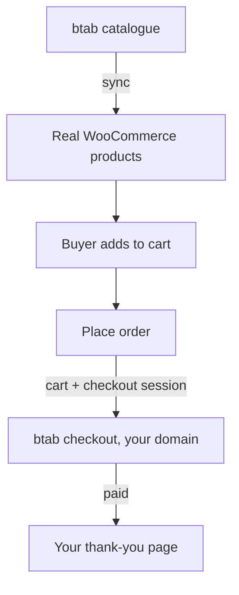

# btab for WooCommerce

Sell btab products from your own WooCommerce shop, on your own domain, with no btab in the address. Products are copied into WooCommerce and kept fresh; the buyer checks out on btab.

**Status: v0, in progress.** Product import works; delivery and checkout come next. See [CHANGELOG.md](CHANGELOG.md) for what each release contains.

## How it works

1. **Sync** copies btab's products in as real WooCommerce products. btab tells your shop the moment something changes, so a price or stock change lands in seconds; the scheduled run is the nightly safety net.
2. The buyer **adds to cart** on your shop, like any other product.
3. **Place order** hands the cart to btab, which prices every line and opens a checkout session.
4. The buyer **pays** on your own domain and comes back to your thank-you page.

Three decisions worth knowing, because they are what keeps the shop behaving like a normal WooCommerce shop:

- **Products are real WooCommerce products.** Not shells with a live price filter, and not a custom data store. Woo's sort-by-price, price and stock filters, Product Collection, sitemaps, search and JSON-LD all read the *stored* values, so anything else shows one price and sorts by another.
- **Nothing calls btab while a page renders.** Product pages stay ordinary, cacheable WordPress pages. btab is called when it tells your shop something changed, on the nightly reconcile, on "Sync now", and at "Place order".
- **Orders are kept right by btab, not by the buyer's browser.** btab tells your shop when a checkout was paid, so an order whose buyer closed the tab instead of returning to your thank-you page is still marked paid. A full refund by the supplier moves the order to Refunded, and wp-admin's own Refund button is hidden on these orders — pressing it would move money on your gateway, which never took any.
- **Your shop hears about changes; it does not wait for a clock.** btab sends a signed message when one of your products changes, and only that product is updated. Your shop verifies the signature over the raw bytes before it reads anything, refuses a message more than five minutes old, and ignores a repeat. The scheduled run exists to catch what a message missed — never as the way your shop keeps up.
- **A price in WooCommerce is a cached copy.** btab prices every line at checkout, exactly as a btab storefront re-prices a cached page. The plugin never sends a price.

## For a shop owner, or a developer building one

**What it does.** Your WooCommerce shop sells btab's products as if they were your own. The plugin copies them in as real WooCommerce products — title, price, photos, stock, variants, categories — and keeps them fresh. When a buyer presses **Place order**, the cart is handed to btab, which prices every line and takes the payment. You keep your own domain, your own theme and your own emails.

**What a buyer sees: your shop, and nothing else.** No btab in any address, image URL, page text or markup. The plugin copies product photos into your own Media Library rather than linking btab's image host, and keeps btab out of every id, class and visible string — including the ones nobody sees on screen, like a form field's id. Product and category pages load no plugin files at all. The checkout loads one small script, because WooCommerce's block checkout will not show a payment option that does not register itself in JavaScript; it is served from **your** domain at a plain address, it names nothing, and it does nothing but draw the payment option. The project treats a buyer finding btab anywhere as a bug, and checks it by reading the page source and the network rather than the screen.

### Get a key
1. Sign in to your btab dashboard.
2. **Settings → Developers → Storefront keys**.
3. Make a **publishable** key (`btab_pk_live_…`). Add your shop's address to the key's allowed sites — including the page buyers return to after paying.
4. A `btab_pk_test_…` key reads btab's demo store and never charges anyone. Start there.

Never paste a **store API key** (`btab_live_…`). It is not a shop-window key, and the plugin refuses it before it is ever sent.

### Install
1. Download `btab-woocommerce.zip` from the latest [release](https://github.com/SteveDeals/btab-for-woocommerce/releases).
2. **Plugins → Add New → Upload Plugin**, choose the zip, activate.
3. **WooCommerce → btab**, paste the key, **Save**, then **Test connection**.
4. **Sync now**. Your products appear under Products, marked as btab's.

You only download it by hand once. After that the plugin appears on your own **Dashboard → Updates** screen like any other plugin. btab signs every release, and an update that is not properly signed is refused rather than installed, so your shop can never be handed somebody else's code in btab's name.

Requires WordPress 6.5+, WooCommerce 9.0+ and PHP 7.4+.

### What works, and what does not yet
Said plainly, because a plugin that implies more than it does wastes your afternoon:

| | |
|---|---|
| Product import, photos, variants, sold-out, enquiry-only | **works** |
| Delivery quoted by btab at the cart | **works** |
| Handing the cart to btab checkout at Place order | **works** |
| Copying paid and refunded orders back into WooCommerce | **works** |
| Updating itself when btab publishes a new version | **works** |
| **Tracking numbers copied back into WooCommerce** | **not yet** — btab's order messages do not carry them |
| A mixed cart: btab's products and your own goods together | not yet — there is no honest single freight price for the two, so such a cart is refused with a line asking for two orders |
| Your own variations added to a btab product | not bought — btab cannot ship a variation it has never heard of, so one you add is shown but cannot be bought |

### Try it without charging anyone
Make a **test key** (`btab_pk_test_…`) in the same place as a live one. It reads btab's demo store of made-up goods, and its checkout ends in "Place test order" — nothing is charged and nothing is sent. The webhook for such an order says `"livemode": false`. Swap in the live key when you are happy.

## Support and security

| | |
|---|---|
| A bug or a question | [open an issue](https://github.com/SteveDeals/btab-for-woocommerce/issues) |
| A security problem | **email developers@btab.app**, not an issue — see [SECURITY.md](SECURITY.md) |
| What changed in a release | [CHANGELOG.md](CHANGELOG.md) |

## Licence

GPL-2.0-or-later. See [LICENSE](LICENSE).

WordPress plugins are GPL by WordPress's own rules, so this code is readable by anyone who installs it. It holds no secret: it does nothing without a publishable key that a store makes, and can revoke, in its own btab dashboard.

## Settings

| | |
|---|---|
| **API base** | `https://api.btab.app/api/storefront/v1`. Leave it alone unless btab says otherwise. |
| **Publishable key** | `btab_pk_live_…` from btab: Settings → Developers → Storefront keys. A `btab_pk_test_…` key reads btab's demo store and never charges. |
| **Resync** | How often WP-Cron pulls the catalogue again. |

**Never paste a store API key (`btab_live_…`).** It is not a shop-window key, and the plugin refuses it before it is ever sent.

## Layout

| Path | What |
|---|---|
| `btab-woocommerce.php` | the plugin header, constants and wiring |
| `lib/` | **portable PHP core, no WordPress.** The API client lives here so PrestaShop can reuse it unchanged |
| `includes/` | everything WordPress- and WooCommerce-specific |
| `.github/workflows/release.yml` | builds `btab-woocommerce.zip` for each `v*` tag |

`lib/` must not call a WordPress function, a Woo class or a superglobal. WordPress's own HTTP API is injected into the client as a transport instead, so a shop's proxy and CA bundle still apply.

## The API

Everything the plugin does is in btab's published Storefront API: `GET /site`, `GET /products`, `POST /carts`, `POST /carts/{id}/shipping-estimate`, `POST /carts/{id}/enquiry`, `POST /checkout_sessions`. The contract is `docs/api/STOREFRONT_API.md` in btab-api, read at `origin/main` **de32e9fd**.

## Proof

Filled in as each milestone lands: screenshots of the imported products and the checkout redirect, and the order number from a test shop.
